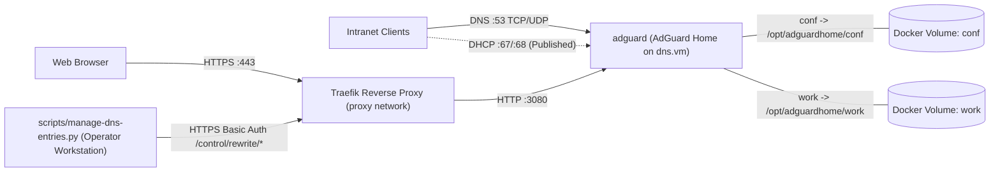

# AdGuard Home

> Version: `v0.107.79` | Image: `adguard/adguardhome:v0.107.79` | Upstream: https://github.com/AdguardTeam/AdGuardHome

Network-wide DNS resolver, ad/tracker sinkhole, and custom DNS rewrite server for the homelab intranet, deployed on `dns.vm.xbhl.intranet`.

## Service Overview

| Property | Value |
| :--- | :--- |
| **Domain** | `https://adguard.intranet.xbhl.online` |
| **Primary Node** | `dns.vm.xbhl.intranet` (`Proxmox VM`) |
| **Deploy Path** | `/opt/containers/adguard` |
| **Ingress Strategy** | `direct` (Traefik TLS reverse proxy -> HTTP `:3080`; host DNS `:53/tcp+udp`, DHCP `:67/udp` & `:68/tcp+udp`, initial setup `:3000/tcp`, admin HTTP `:3080/tcp`) |
| **Topology Archetype** | `Standalone Application` |
| **Authentication** | Native AdGuard Home authentication (Web UI session login & HTTP Basic Auth on `/control/*`; no Authelia middleware or OIDC) |
| **Ecosystem** | Monitored by [Gatus](https://status.intranet.xbhl.online) (`adguard` group: 3 DNS resolution probes, HTTPS login check, and container health check) and tracked by What's Up Docker (`wud.watch=true`); not registered as an application tile on Homepage or in Authelia |

## Architecture & Communication



### Runtime Topology, Storage & Healthcheck

- **Single-Instance Topology**: Deployed as a single `adguard` container (`adguard/adguardhome`) on `dns.vm.xbhl.intranet` (`/opt/containers/adguard`) via the shared `docker-compose-service-deployment` CI/CD component (`cloudflare-dns-strategy: "direct"` managing the unproxied Cloudflare `A` record for `adguard.intranet.xbhl.online`). No secondary DNS replica or `adguardhome-sync` sidecar is deployed.
- **Networking & Published Ports**: Joins the external `proxy` Docker bridge network (`traefik.docker.network=proxy`), where Traefik router `adguard-router` (`entrypoints=websecure`, `tls=true`) forwards `https://adguard.intranet.xbhl.online` to `http://adguard:3080`. Host ports `53:53/tcp`, `53:53/udp` (DNS), `67:67/udp`, `68:68/tcp`, `68:68/udp` (DHCP), `3000:3000/tcp` (initial setup wizard), and `3080:3080/tcp` (admin HTTP listener configured in `AdGuardHome.yaml`) are published on `dns.vm.xbhl.intranet`, while `80` and `443` remain commented out so Traefik retains `:80`/`:443` on the host.
- **Persistent Volumes**: Configuration (`AdGuardHome.yaml`) and runtime data (filter lists, query logs, statistics) are stored exclusively in local Docker named volumes `conf:/opt/adguardhome/conf` and `work:/opt/adguardhome/work`. `.gitlab-ci.yml` sets `delete-existing-container-files: true`, wiping `/opt/containers/adguard` prior to syncing `src/docker-compose.yml`.
- **Dual-Mode Healthcheck**: Runs every `15s` (`start_period: 5s`, `timeout: 5s`, `retries: 1`). When `/opt/adguardhome/conf/AdGuardHome.yaml` is present, it queries `nslookup -type=a google.com 127.0.0.1`; when uninitialized (first boot or ephemeral DinD `test:adguard:docker-compose` validation), it probes `http://127.0.0.1:3000` via `wget --quiet --tries=1 --spider`.

### Directory Structure

```text
├── .gitlab-ci.yml                  # Shared docker-compose-service-deployment pipeline targeting dns.vm.xbhl.intranet
├── scripts/
│   └── manage-dns-entries.py       # Standalone operator CLI for /control/rewrite/* (not deployed to dns.vm)
└── src/
    └── docker-compose.yml          # AdGuard Home service, named volumes (conf, work), Traefik & WUD labels
```

## DNS Rewrite Management CLI

`scripts/manage-dns-entries.py` is a standalone Python 3 standard-library CLI executed from an operator workstation (it is outside `src/` and is not deployed to `dns.vm.xbhl.intranet`). It authenticates with HTTP Basic Auth (`-u`/`--url` or `AGH_URL`, `-U`/`--user` or `AGH_USER`, `-P`/`--password` or `AGH_PASSWORD`) against the AdGuard Home REST API:

| Subcommand | REST Endpoint(s) | Behavior |
| :--- | :--- | :--- |
| `list` | `GET /control/rewrite/list` | Prints all configured custom DNS rewrite rules as formatted JSON. |
| `add -d <domain> -a <answer>` | `POST /control/rewrite/add` | Appends a new DNS rewrite mapping `<domain>` to `<answer>`. |
| `set -d <domain> -a <answer>` | `GET /control/rewrite/list` + `add` / `PUT /control/rewrite/update` / `delete` | Idempotently upserts `<domain> -> <answer>` (collapsing duplicate entries if multiple exist). |
| `update -d <domain> -a <answer> [-nd ...] [-na ...]` | `PUT /control/rewrite/update` | Updates an existing rewrite rule matching `<domain>` and `<answer>`. |
| `delete -d <domain> -a <answer>` | `POST /control/rewrite/delete` | Removes the matching `<domain> -> <answer>` rewrite entry. |

## Required GitLab CI/CD Variables

No project-level GitLab CI/CD variables are required. `.gitlab-ci.yml` consumes only group-inherited variables from `home-lab`:

| Variable | Component Input | Purpose |
| :--- | :--- | :--- |
| `SSH_USER` | `vm-ssh-username` | SSH deployment user for `dns.vm.xbhl.intranet` |
| `SSH_PRIVATE_KEY` | `vm-ssh-private-key` | Base64-encoded SSH private key for `dns.vm.xbhl.intranet` |
| `CLOUDFLARE_ZONE_ID` | `cloudflare-zone-id` | Cloudflare Zone ID for `xbhl.online` |
| `CLOUDFLARE_DNS_API_TOKEN` | `cloudflare-dns-api-token` | Cloudflare API token managing the `direct` `A` record for `adguard.intranet.xbhl.online` |

## Upgrades & Maintenance

- **Upstream & Wrapper Sources**: Standard (tracked via `wud.link.template`); consult the [Configuration Wiki](https://github.com/AdguardTeam/AdGuardHome/wiki/Configuration) for `AdGuardHome.yaml` `schema_version` migrations and [`openapi/openapi.yaml`](https://github.com/AdguardTeam/AdGuardHome/blob/master/openapi/openapi.yaml) for REST API changes.
- **Version & Flavor Constraints**: Official `adguard/adguardhome` image locked to stable `^v\d+\.\d+\.\d+$$` semver tags; image must retain `/bin/sh`, `nslookup`, and `wget` used by the container `healthcheck`.
- **Intentional Choices (Do Not Propose)**: Runs on the external `proxy` bridge network instead of `network_mode: host`, keeps `80`/`443` commented out while publishing `:53`, `:67`/`:68`, `:3000`, and `:3080` so Traefik terminates TLS on `dns.vm.xbhl.intranet` and proxies to `:3080`, omits Authelia middleware (uses native auth and HTTP Basic Auth for `/control/*`), and stores state in Docker named volumes (`conf`, `work`) rather than Git-tracked config or NFS mounts.
- **Upgrade & CI Gotchas**: Preserve both `healthcheck` branches (`nslookup` when `AdGuardHome.yaml` exists in production, `wget` on `:3000` when uninitialized so DinD `test:adguard:docker-compose` passes with an empty `conf` volume); `delete-existing-container-files: true` wipes `/opt/containers/adguard` on deploy so state must never move to relative bind mounts; verify `scripts/manage-dns-entries.py` whenever `/control/rewrite/{list,add,update,delete}` changes.
