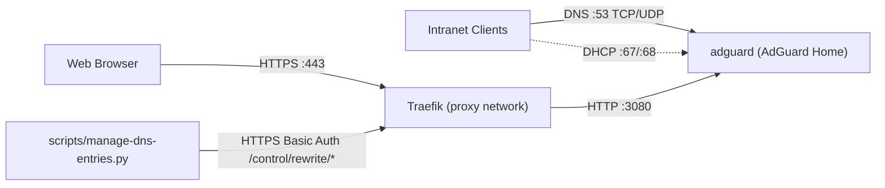

# AdGuard Home

> Version: `v0.107.79` | Image: `adguard/adguardhome:v0.107.79` | Upstream: https://github.com/AdguardTeam/AdGuardHome

Network-wide intranet DNS resolver, ad/tracker sinkhole, and custom DNS rewrite server.

## Overview

| Property | Value |
| :--- | :--- |
| **Domain** | `https://adguard.intranet.xbhl.online` |
| **Node** | `dns.vm.xbhl.intranet` |
| **Ingress** | Traefik TLS reverse proxy to HTTP `:3080`; host DNS `:53`, DHCP `:67`/`:68`, and setup/admin `:3000`/`:3080` published |
| **Authentication** | Native Web UI login and HTTP Basic Auth on `/control/*` (no Authelia middleware) |
| **Ecosystem** | Monitored by [Gatus](https://status.intranet.xbhl.online) (DNS, HTTPS login, and container probes) and tracked by WUD |

## Architecture & Key Decisions



- **Host DNS/DHCP & Bridge Ingress Coexistence**: Publishes DNS (`:53`), DHCP (`:67`/`:68`), initial setup (`:3000`), and admin HTTP (`:3080`) on `dns.vm.xbhl.intranet` while joining the `proxy` bridge network and keeping host `:80`/`:443` free so Traefik handles TLS termination (`cloudflare-dns-strategy: "direct"`).
- **Native Admin & API Authentication**: Relies on AdGuard Home's built-in session login for the Web UI and HTTP Basic Auth on `/control/*` without Authelia forward-auth middleware, keeping DNS administration reachable during SSO maintenance and directly accessible to CLI tooling.
- **Dual-Mode Healthcheck**: Queries local DNS via `nslookup` against `127.0.0.1` once `AdGuardHome.yaml` is initialized, falling back to a `wget` check against the `:3000` setup wizard on first boot and uninitialized CI DinD compose test runs.

## DNS Rewrite Management CLI

`scripts/manage-dns-entries.py` is a standalone operator CLI (not deployed to `dns.vm.xbhl.intranet`) that manages custom DNS rewrites via `/control/rewrite/*` using HTTP Basic Auth (`-u`/`--url` or `AGH_URL`, `-U`/`--user` or `AGH_USER`, `-P`/`--password` or `AGH_PASSWORD`):

```bash
./scripts/manage-dns-entries.py list
./scripts/manage-dns-entries.py set -d host.intranet.xbhl.online -a 192.168.1.10     # idempotent upsert (collapses duplicates)
./scripts/manage-dns-entries.py add -d host.intranet.xbhl.online -a 192.168.1.10
./scripts/manage-dns-entries.py update -d host.intranet.xbhl.online -a 192.168.1.10 -na 192.168.1.20 [-nd <new-domain>]
./scripts/manage-dns-entries.py delete -d host.intranet.xbhl.online -a 192.168.1.20
```

## Upgrades & Maintenance

- **Upstream & Wrapper Sources**: Standard (`wud.link.template`); consult the [Configuration Wiki](https://github.com/AdguardTeam/AdGuardHome/wiki/Configuration) for `AdGuardHome.yaml` `schema_version` migrations and [`openapi/openapi.yaml`](https://github.com/AdguardTeam/AdGuardHome/blob/master/openapi/openapi.yaml) for REST API changes.
- **Version & Flavor Constraints**: Official `adguard/adguardhome` image locked to stable `^v\d+\.\d+\.\d+$$` semver tags; image must retain `/bin/sh`, `nslookup`, and `wget` used by the container healthcheck.
- **Intentional Choices (Do Not Propose)**: Runs as a single instance on the `proxy` bridge network instead of `network_mode: host`, leaves host `:80`/`:443` unpublished so Traefik terminates TLS on `dns.vm.xbhl.intranet`, and omits Authelia middleware in favor of native Web UI and `/control/*` Basic Auth.
- **Upgrade & CI Gotchas**: Preserve both healthcheck branches (`nslookup` when `AdGuardHome.yaml` exists, `:3000` `wget` fallback when uninitialized so CI DinD `test:adguard:docker-compose` passes), and verify `scripts/manage-dns-entries.py` whenever `/control/rewrite/{list,add,update,delete}` changes.
